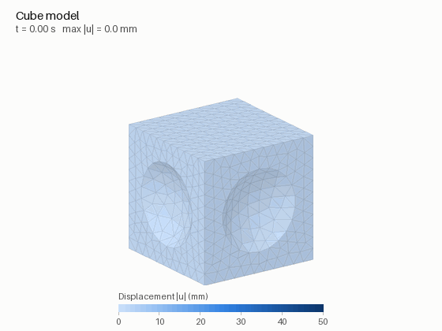
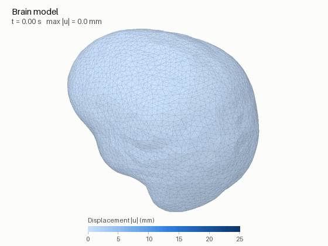

# JANP-DJTLED-GPU

Explicit dynamic finite element solvers for nearly incompressible soft tissue, on the CPU (OpenMP) and on the GPU (CUDA).

The solvers implement DJTLED, the direct Jacobian total Lagrangian explicit dynamics algorithm, with the average nodal pressure (ANP) formulation. ANP removes the volumetric locking that plain 4-node tetrahedra suffer from when Poisson's ratio approaches 0.5. Elements are 4-node tetrahedra and the material is neo-Hookean.

| Cube model | Brain model |
|:---:|:---:|
|  |  |

Both animations are from the CPU solver at Poisson's ratio 0.49, coloured by displacement magnitude. The cube is `models/NH_049.txt`; the brain model is not included in this repository.

DJTLED is described in:

> Zhang, J. (2021). A direct Jacobian total Lagrangian explicit dynamics finite element algorithm for real-time simulation of hyperelastic materials. *International Journal for Numerical Methods in Engineering*, 122(20), 5744–5772. [doi:10.1002/nme.6772](https://doi.org/10.1002/nme.6772)

The original DJTLED code is on GitHub: [jinaojakezhang/DJTLED](https://github.com/jinaojakezhang/DJTLED).

## What is in the repository

| Path | What it is |
|---|---|
| `src/JANP-DJTLED_CPU.cpp` | CPU solver, parallel with OpenMP |
| `src/JANP-DJTLED_CUDA.cu` | GPU solver, CUDA |
| `src/vtk_output.h` | VTK export and timers shared by both solvers |
| `models/` | Model files (see [Model files](#model-files)) |
| `reference results/` | Final displacements from a reference implementation, used to check accuracy |
| `run.py` | Builds and runs selected solvers on selected models |
| `compare.py` | Compares results with the reference, or GPU results with CPU results |
| `run_cuda_colab.ipynb` | Runs the GPU solver on Google Colab |
| `JANP-DJTLED_Method.pdf` | The method: formulation, and the CPU and GPU implementations. Its equation numbers are the ones cited in `src/JANP-DJTLED_CPU.cpp` |
| `docs/` | The animations shown in this README |

`bin/` (compiled programs) and `results/` (solver output) are created when you run and are not tracked by git.

## Requirements

- Python 3.8 or later. `run.py` and `compare.py` use the standard library only.
- **CPU solver, macOS:** Apple clang plus OpenMP from Homebrew: `brew install libomp`.
- **CPU solver, Linux:** GCC with OpenMP (`g++`).
- **GPU solver:** an NVIDIA GPU and the CUDA Toolkit (`nvcc`). Without them `run.py` skips the GPU solver and runs the rest.

## Quick start

From the repository root:

```bash
python3 run.py --list      # the solvers and models that can be selected
python3 run.py             # build and run everything, all outputs, into results/
python3 compare.py         # check the final states against the reference results
```

`run.py` compiles a solver into `bin/` when its program is missing or older than its source, so there is no separate build step.

## Running: `run.py`

```bash
python3 run.py -a JANP-DJTLED_CPU -m NH_049 --times
python3 run.py -a JANP-DJTLED_CPU -m NH_049 NH_0499 --final --animation --frames 50
python3 run.py --times --repeat 5 --threads 4
```

| Option | Meaning | Default |
|---|---|---|
| `-a`, `--algorithms` | Solvers to run: the file names in `src/` without extension | all |
| `-m`, `--models` | Model names from `models/`, or paths to model files | all |
| `--final` | Keep the final state | see below |
| `--animation` | Keep the animation | see below |
| `--times` | Print the computation times and save `computation_times.csv` | see below |
| `--frames N` | Number of animation frames | 100 |
| `--threads N` | OpenMP threads | all cores |
| `--repeat N` | Run each case N times and report the median and best time | 1 |
| `--out DIR` | Output folder | `results/` |

With none of `--final`, `--animation` and `--times`, all three are produced.

On processors that mix fast and slow cores, fewer threads can be faster than all of them. Try `--threads 4`.

### Output files

Every output starts with `<algorithm>_<model>`:

| File | Contents |
|---|---|
| `<algorithm>_<model>_u.vtk` | Final deformed mesh with the displacement vectors |
| `<algorithm>_<model>_undeformed.vtk` | Undeformed mesh with the final displacement vectors |
| `<algorithm>_<model>_simulation.vtk.series` | Animation index: open this file in ParaView |
| `<algorithm>_<model>_timesteps/` | The animation frames |

The reported computation time covers the time-step loop only. Writing VTK files is timed separately.

## Checking accuracy: `compare.py`

```bash
python3 compare.py                     # every result in results/ against its reference
python3 compare.py -m NH_0499          # one model only
python3 compare.py --cpu-gpu           # GPU against CPU: accuracy and computation time
python3 compare.py --pair A.vtk B.vtk  # any two files
```

For each pair it reports the maximum displacement in x, y, z and magnitude for both files, their difference, and the largest node-by-node difference. A result counts as a match when the largest nodal difference is within 0.1% of the reference's maximum displacement (change with `--tolerance`).

**How a result finds its reference:** the reference must be named `<formulation>_<tag>_U.vtk`, where `<tag>` is the last word of the model name. Results for `NH_0499` are compared with `T4ANP_0499_U.vtk`.

**How GPU and CPU results are paired:** same model, and solver names that start with the same word, so `JANP-DJTLED_CUDA` is compared with `JANP-DJTLED_CPU`.

**Computation time:** `--cpu-gpu` also sets each GPU time beside the CPU time for the same model and gives the speed-up. It reads the times from `computation_times.csv`, which `run.py --times` writes, so run both solvers in the same `run.py` call.

**HTML view:** every run also writes `results/comparison.html`, one page with all the comparisons the results folder allows: charts, tables and headline numbers. Run from a terminal, it opens in the browser; `--no-open` stops that.

### Current results

Largest nodal difference, as a percentage of the maximum displacement (pass mark 0.1%):

| Model | CPU solver vs reference | GPU solver vs reference | GPU solver vs CPU solver |
|---|---|---|---|
| `NH_049` | 0.022% | 0.025% | 0.003% |
| `NH_0499` | 0.015% | 0.012% | 0.008% |

Computation time on one Google Colab machine, time-step loop only, median of 3 runs:

| Model | Steps | CPU solver (ms) | GPU solver (ms) | GPU speed-up |
|---|---|---|---|---|
| `NH_049` | 5,000 | 1,121.8 | 103.6 | 10.8× |
| `NH_0499` | 10,000 | 2,367.5 | 205.1 | 11.5× |

The CPU figures in the first column of the accuracy table are from macOS; the GPU figures and all the times are from Colab.

## Running on a GPU with Colab

Open `run_cuda_colab.ipynb` in Google Colab and run the cells from top to bottom. It checks for a GPU, loads the project, builds and runs the CUDA solver, compares the result with the reference and with the CPU solver, and downloads the results.

To load the project, either give the notebook the address of a public copy of this repository, or upload a zip of the project folder when it asks.

## Model files

A model is one plain-text file:

```
<node index> <x> <y> <z>                  one line per node
NH <shear modulus> <bulk modulus>         material: neo-Hookean
Density <density>
T4
<element index> <n1> <n2> <n3> <n4>       one line per tetrahedron
<Disp>                                    prescribed displacement, ramped linearly over the run
<x|y|z> <displacement>
<node indices ...>
<FixP>                                    fixed nodes
<x|y|z|all>
<node indices ...>
<Gravity>                                 optional
<x|y|z> <acceleration>
</BC>
Damping <mass-proportional damping coefficient>
TimeStep <time step>
TotalTime <total time>
```

Poisson's ratio is not given directly. It follows from the shear modulus μ and the bulk modulus κ:

ν = (3κ − 2μ) / (2(3κ + μ))

A larger bulk modulus needs a smaller time step, because the solver is explicit.

### Models included

Both use the same mesh: a cube with four circular cuts, 1,695 nodes and 7,726 tetrahedra, stretched by 50 mm at one end with the other end fixed.

| Model | Shear modulus | Bulk modulus | Poisson's ratio | Time step |
|---|---|---|---|---|
| `NH_049` | 6567 | 326210 | 0.49 | 0.0002 |
| `NH_0499` | 6567 | 3281311 | 0.499 | 0.0001 |

## Building by hand

`run.py` does this for you. To build a solver directly, from the repository root:

```bash
mkdir -p bin

# CPU solver, macOS
clang++ -std=c++17 -O3 -Xclang -fopenmp -I"$(brew --prefix libomp)/include" \
  src/JANP-DJTLED_CPU.cpp -L"$(brew --prefix libomp)/lib" -lomp -o bin/JANP-DJTLED_CPU

# CPU solver, Linux
g++ -std=c++17 -O3 -fopenmp src/JANP-DJTLED_CPU.cpp -o bin/JANP-DJTLED_CPU

# GPU solver
nvcc -std=c++17 -O3 src/JANP-DJTLED_CUDA.cu -o bin/JANP-DJTLED_CUDA
```

A solver takes the model file and, optionally, the number of animation frames (default 100, `0` for none), and writes its output into the current folder:

```bash
cd results
../bin/JANP-DJTLED_CPU ../models/NH_049.txt 0
```

## Status and limitations

- The CPU solver has been built and run on macOS (Apple clang) and on Linux (GCC, on Google Colab), and matches the reference results on both.
- The GPU solver has been built and run on a Google Colab GPU. Its results match the CPU solver and the reference results for both included models.
- Only the neo-Hookean material and 4-node tetrahedra are implemented.
- The CPU and GPU solvers compute the ANP volume ratio in two different ways (from Jacobian determinants on the CPU, from nodal pressures on the GPU). The two are mathematically equal for a single material.

## License

Released under the MIT License, copyright Jinao Zhang and Baiqi Cheng. See [LICENSE](LICENSE).
